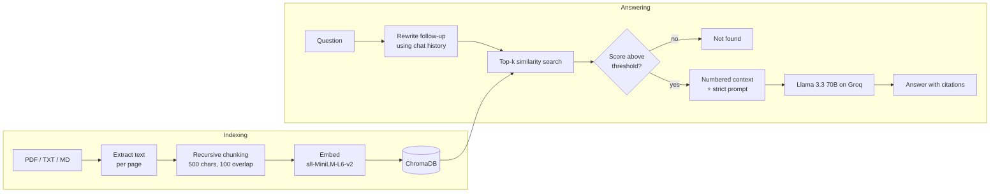

# 📄 RAG Document Chat

Chat with your PDFs. Upload documents, ask questions in plain language, and get answers that **cite the exact passage and page** they came from. When the answer is not in your documents, the app says so instead of making something up.


## Features

- **PDF, TXT and Markdown upload** with page numbers kept for every chunk
- **Answers with citations** like `[1]`, plus an expandable list of the source passages and their similarity scores
- **"Not found" instead of hallucinating** when no passage is relevant enough
- **Follow-up questions** such as "and for interns?" are rewritten into full questions before searching
- **Local embeddings**: documents are embedded on your machine, so indexing needs no API key
- **Persistent index**: documents stay indexed between sessions, and you can remove a single file
- **Retrieval evaluation** script that measures search quality for different chunk sizes

## How it works



1. **Load:** `pypdf` extracts text page by page, so every chunk remembers its page.
2. **Chunk:** a recursive splitter, written from scratch, cuts on paragraphs first, then lines, sentences and words. Neighbouring chunks overlap so an answer on a boundary is not lost.
3. **Embed and store:** ChromaDB embeds chunks locally with `all-MiniLM-L6-v2` and stores them with cosine similarity.
4. **Retrieve:** the top 4 chunks are fetched, and chunks below a similarity threshold are dropped.
5. **Generate:** the LLM gets numbered passages and strict rules: use only these passages, cite every claim, and reply with a fixed "not found" message otherwise.

## Evaluation

[`eval/evaluate.py`](eval/evaluate.py) checks whether the passage that contains the answer is retrieved, for 14 questions over two sample documents. It reports:

- **Hit@4:** the share of questions whose answer passage is in the top 4 results.
- **MRR (mean reciprocal rank):** 1.0 means the answer passage was always ranked first.

| Chunk size | Overlap | Chunks | Hit@4 | MRR |
|---|---|---|---|---|
| 300 | 50 | 23 | 1.00 | 1.00 |
| **500** | **100** | **15** | **1.00** | **1.00** |
| 800 | 150 | 9 | 1.00 | 0.88 |
| 1200 | 200 | 5 | 1.00 | 0.89 |

Larger chunks still contained the answer but ranked it lower, because each chunk mixes several topics. I chose **500 / 100** as the default because it keeps a perfect ranking with fewer chunks than 300.

**Choosing the "not found" threshold.** With 500-character chunks, the best passage for each of the 14 answerable questions scored between 0.32 and 0.83 cosine similarity. Unrelated questions ("What is the capital of France?", "How do I bake bread?") scored between 0.03 and 0.23. The default `MIN_SCORE` of 0.25 sits between the two groups.

The sample documents in [`data/sample`](data/sample) are short and fictional, so these scores are an upper bound. Real PDFs with tables and repeated wording will score lower. Run the evaluation on your own questions before trusting a setting.

```bash
python -m eval.evaluate            # retrieval only, no API key needed
python -m eval.evaluate --answers  # also prints the LLM's answer to each question
```

## Run it

1. Get a free Groq API key at [console.groq.com/keys](https://console.groq.com/keys).
2. Install and configure:

```bash
git clone https://github.com/usamaamjad1579/rag-document-chat.git
cd rag-document-chat
pip install -r requirements.txt
cp .env.example .env   # then paste your GROQ_API_KEY into .env
```

3. Start the app:

```bash
streamlit run app.py
```

4. Upload the files in `data/sample` (or your own PDFs), click **Index files**, and ask a question such as "How many days of annual leave do I get?"

The embedding model (about 80 MB) downloads automatically the first time you index a document.

## Tests

```bash
pytest
```

16 tests run offline in about a second. They use a hashing embedding and a fake LLM, so they need no network or API key. They cover chunk size limits, overlap, page metadata, citation parsing, the similarity threshold, follow-up rewriting, and deleting a document from the index.

## Project structure

```
rag/
  loader.py     # PDF / text loading, page by page
  chunker.py    # recursive splitter with overlap
  store.py      # ChromaDB wrapper: add, search, list, delete
  pipeline.py   # rewrite -> retrieve -> prompt -> answer with citations
  llm.py        # Groq chat client
  config.py     # settings from environment variables
app.py          # Streamlit chat UI
eval/           # retrieval evaluation and test questions
data/sample/    # two fictional sample documents
tests/          # offline unit tests
```

## Configuration

All settings can be changed in `.env`:

| Variable | Default | Meaning |
|---|---|---|
| `GROQ_MODEL` | `llama-3.3-70b-versatile` | Any chat model available on Groq |
| `CHUNK_SIZE` / `CHUNK_OVERLAP` | `500` / `100` | Characters per chunk and shared between neighbours |
| `TOP_K` | `4` | Passages sent to the model |
| `MIN_SCORE` | `0.25` | Minimum cosine similarity for a passage to count |

## Limitations and next steps

- Scanned PDFs need OCR first. `pypdf` reads only embedded text.
- Retrieval uses vector search only. Adding keyword search (BM25) and a re-ranker would help with exact names and codes.
- The evaluation measures retrieval, not answer faithfulness. The next step is an LLM-as-judge check that every cited sentence is supported by its passage.

## License

MIT
